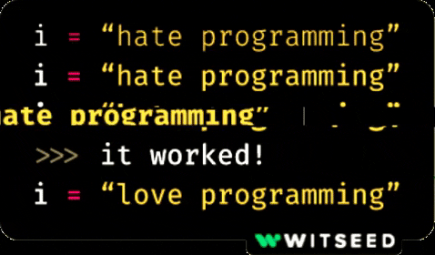

---

<h2>🌷 A Little About Me</h2>

- 💻 Computer Engineer
- 📊 Aspiring Data Analyst
- 🌱 Exploring Data Analytics & Visualization
- 🎀 Building projects, one dataset at a time
- 📚 A book lover with a curious mind
- ✨ Turning curiosity into knowledge
- 💜 Passionate about continuous learning

 

<i>“Learning, creating, and growing — one line at a time.”</i>

 

---
